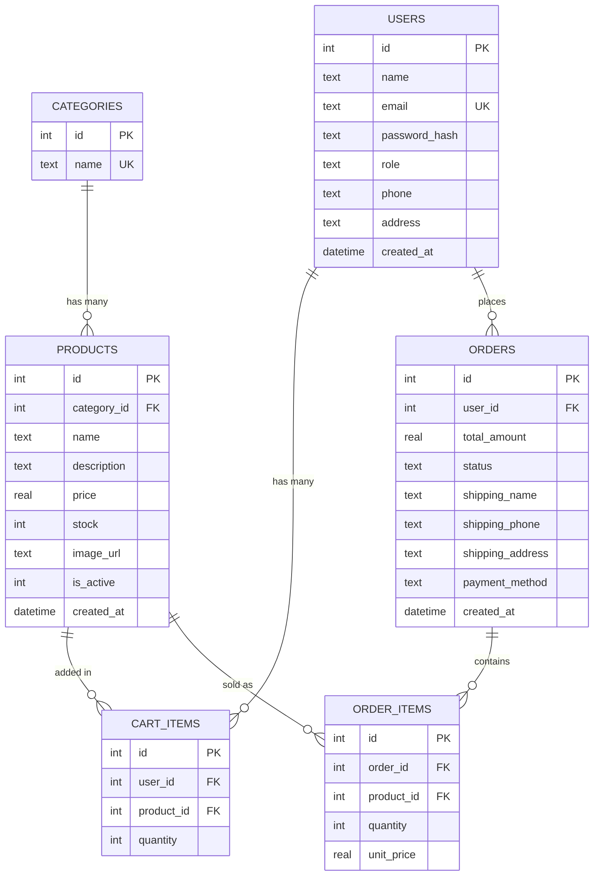

# ShopEasy - E-Commerce Application

A full-stack e-commerce web application (MVP) where customers can browse products, add them to a cart and place Cash on Delivery orders, and an admin can manage products, categories and orders.

Built as an internship project using **HTML, CSS, JavaScript, Node.js, Express and SQLite**.


## Features

**Customer**
- Register, login and logout (JWT authentication)
- Product listing with search, category filter, sorting and pagination
- Product detail page with stock status
- Shopping cart (add, update quantity, remove) with live count badge
- Checkout with shipping address validation (Cash on Delivery)
- Order confirmation and order history

**Admin**
- Dashboard with total products, orders, customers and sales
- Product management (add, edit, deactivate) with low-stock highlight
- Category management
- View all orders and update status (Placed -> Shipped -> Delivered)

## Tech Stack

| Layer | Technology |
|---|---|
| Frontend | HTML5, CSS3, Vanilla JavaScript (Fetch API) |
| Backend | Node.js, Express.js |
| Database | SQLite (better-sqlite3) |
| Security | bcrypt (password hashing), JWT (authentication) |

## Security Highlights

- Passwords stored as bcrypt hashes, never plain text
- JWT-protected routes and role-based access (customer vs admin), enforced on the server
- Parameterized SQL queries to prevent SQL injection
- User content escaped in the DOM to prevent XSS
- Input validation on both client and server
- Secrets kept in `.env` (not committed)

## Database Design

Tables: `users`, `categories`, `products`, `cart_items`, `orders`, `order_items`.

## ER Diagram


Order placement runs inside a **database transaction** (create order, save items, reduce stock, empty cart), so either everything succeeds or nothing changes. Order items store the unit price at the time of purchase.

## Project Structure

```
shopeasy/
├── server/
│   ├── app.js          # Express setup
│   ├── db.js           # SQLite connection
│   ├── schema.sql      # Tables
│   ├── seed.sql        # Sample data
│   ├── seed.js         # Seeds data and admin user
│   ├── middleware/     # auth.js, adminOnly.js
│   └── routes/         # auth, products, categories, cart, orders, admin
├── public/
│   ├── css/  js/
│   ├── index.html, product.html, cart.html, checkout.html ...
│   └── admin/
├── .env.example
├── package.json
└── README.md
```

## Setup and Run

1. Clone the repository
```
   git clone <your-repo-url>
   cd shopeasy
```
2. Install dependencies
```
   npm install
```
3. Create a `.env` file (copy from `.env.example`)
```
   PORT=3000
   JWT_SECRET=your_secret_key_here
```
4. Seed the database
```
   node server/seed.js
```
5. Start the server
```
   node server/app.js
```
6. Open http://localhost:3000

## Admin Credentials (demo)

- Email: `admin@shopeasy.com`
- Password: `admin123`

## API Endpoints

| Method | Endpoint | Description | Access |
|---|---|---|---|
| POST | /api/auth/register | Register | Public |
| POST | /api/auth/login | Login, returns JWT | Public |
| GET | /api/auth/me | Current user | Logged in |
| GET | /api/products | List (search, category, page, sort) | Public |
| GET | /api/products/:id | Product detail | Public |
| POST | /api/products | Create product | Admin |
| PUT | /api/products/:id | Update product | Admin |
| DELETE | /api/products/:id | Deactivate product | Admin |
| GET | /api/categories | List categories | Public |
| POST/PUT/DELETE | /api/categories(/:id) | Manage categories | Admin |
| GET | /api/cart | My cart with totals | Customer |
| POST | /api/cart | Add item | Customer |
| PUT | /api/cart/:itemId | Update quantity | Customer |
| DELETE | /api/cart/:itemId | Remove item | Customer |
| POST | /api/orders | Place order (transaction) | Customer |
| GET | /api/orders | My orders | Customer |
| GET | /api/orders/:id | Order detail | Owner/Admin |
| GET | /api/admin/orders | All orders | Admin |
| PATCH | /api/admin/orders/:id/status | Update status | Admin |
| GET | /api/admin/stats | Dashboard counts | Admin |

## Author

Erfan SK - [GitHub](https://github.com/erfansk500-ai)